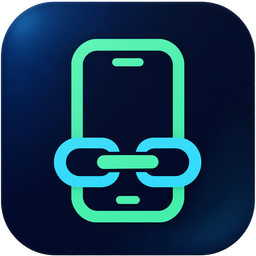
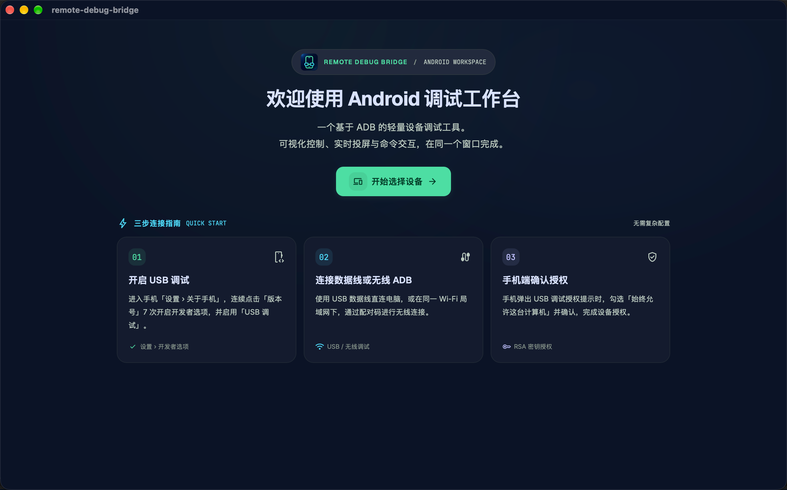
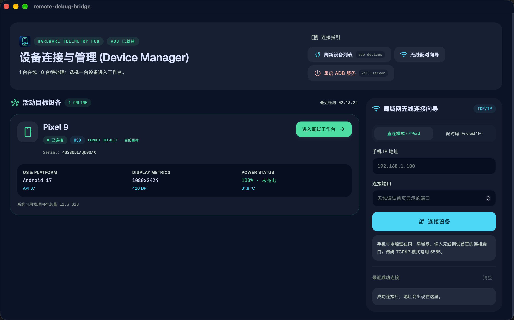
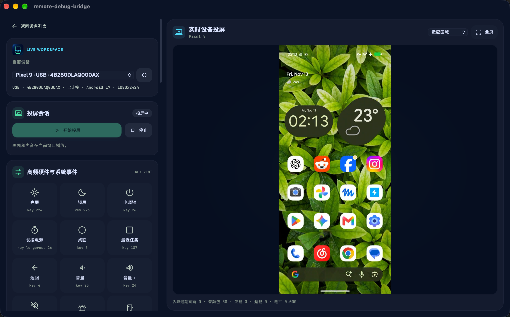

<p align="center">
  
</p>
<h1 align="center">Remote Debug Bridge</h1>
<p align="center">在一个桌面工作台中连接 Android 设备、实时投屏、控制与调试。</p>
<p align="center">Tauri 2 · TypeScript · Rust · 内置 ADB 与 scrcpy-server</p>

## 页面预览

### 欢迎与连接指引

从开启 USB 调试、连接设备到手机端授权，用三步指南开始调试。

<p align="center">
  <a href="docs/screenshots/welcome.png"></a>
</p>

### 设备连接与管理

查看在线设备、连接方式与系统信息，使用无线向导完成直连或配对，选择目标后进入工作台。

<p align="center">
  <a href="docs/screenshots/devices.png"></a>
</p>

### 同页投屏与调试工作台

右侧展示设备实时画面，左侧集中提供会话控制、快捷按键、手势、屏幕参数与命令终端；控制区可独立滚动。

<p align="center">
  <a href="docs/screenshots/workbench.png"></a>
</p>

<sub>以上为用户提供的 macOS 应用实图；点击图片可查看原始尺寸。</sub>

## 功能介绍

| 功能 | 说明 |
| --- | --- |
| USB 与无线连接 | 查看真实设备状态，支持无线直连、配对码连接和成功连接历史；工作台内可切换设备或添加无线设备。 |
| 应用内音视频投屏 | 画面与声音在同一窗口呈现，支持点击、拖动、缩放、全屏，以及电脑端播放音量与静音控制。 |
| 快捷按键与手势 | 亮屏、锁屏、Home、返回、最近任务、音量、通知栏、截图及常用滑动手势。 |
| 屏幕参数调整 | 比例、方向和 DPI 预设点击即应用，也可输入自定义宽高与 DPI；各组提供独立恢复入口。 |
| 单次命令终端 | 在投屏时执行设备端 shell 命令，查看标准输出、错误、退出状态和耗时，支持取消与查询预设。 |
| 修改恢复与会话管理 | 记录本应用修改前的屏幕参数，停止、切换设备或正常退出时尝试恢复；单实例运行，一次操作一个活动设备。 |
| 内置依赖 | 携带官方 Platform-Tools 37.0.1 ADB 与 scrcpy-server 5.0.1，无需另装 ADB 或桌面版 scrcpy，也无需配置 PATH。 |

## 快速使用

1. 在 Android 设备上开启开发者选项与 USB 调试。
2. 使用 USB 数据线连接并在手机上确认授权，或通过无线向导输入连接/配对信息。
3. 选择在线设备进入工作台，点击“开始投屏”，在同一页面操作设备或执行命令。

无线配对端口与连接端口应分别填写手机显示的值。音频当前以 Android 12+ 为验证基线；播放器音量与静音只影响电脑端，设备音量由快捷控制单独调整。

## 平台与当前状态

| 平台 | 内置 ADB 架构 | 应用验证状态 |
| --- | --- | --- |
| macOS | Apple Silicon / Intel 通用二进制 | 主要开发与真机验证平台；已生成 Universal 安装包，Intel 实机仍待验证。 |
| Windows | 官方 x86 ADB，供 Windows x64 应用使用 | 资源已内置，完整应用运行与打包待验证。 |
| Linux | x86_64 | 资源已内置，完整应用运行与打包待验证。 |

Windows/Linux ARM64 暂不支持。Windows USB 驱动和 Linux USB 访问权限由宿主系统提供。各功能验收记录、无线连接与稳定性待验项见[实施路线图](docs/ROADMAP.md)。

## 开发

安装 Rust、Node.js 和对应平台的 [Tauri 系统依赖](https://v2.tauri.app/start/prerequisites/)。

```sh
npm install
python3 scripts/prepare-scrcpy.py --check
python3 scripts/prepare-adb.py --check
npm run tauri dev
```

## 构建

```sh
npm run tauri build
```

macOS 通用 release 安装包（Apple Silicon + Intel）：

```sh
rustup target add aarch64-apple-darwin x86_64-apple-darwin
npm run tauri -- build --target universal-apple-darwin --bundles app,dmg --config '{"bundle":{"macOS":{"signingIdentity":"-"}}}'
```

产物位于 `target/universal-apple-darwin/release/bundle/`：`dmg/` 为安装镜像，`macos/` 为应用。上述命令使用本地 ad-hoc 签名，不含 Apple 公证；正式对外分发需配置 Developer ID 签名与公证。

`npm run dev` 仅启动前端，Rust 调用需要通过 Tauri 启动。

## 工作台使用

- 快捷控制可在未开始投屏时操作在线设备，包括亮屏、锁屏、电源、桌面、最近任务、返回、音量、设备静音、通知栏和截图。截图通过系统保存窗口选择位置，设备重启需要在应用内确认。播放器的静音与音量只改变电脑播放，独立于设备音量。
- 预设手势按设备当前显示区域计算坐标；效果受设备导航方式影响。画面支持适应区域、50% / 75% / 100% 缩放和全屏。
- 尺寸支持预设和自定义整数（每边 200–7680 px），DPI 为 72–1000；可设置方向、固定方向和触控轨迹。应用后会回读设备值，设备仍可能拒绝某些数值。
- 比例和 DPI 分组分别提供恢复设备默认值的按钮，方向组恢复修改前设置；不再显示合并恢复按钮。停止投屏、切换设备及正常退出时自动尝试恢复。断连或强制退出后保留恢复记录，同一 ADB 标识重连后保留恢复提醒；USB 与无线地址暂不自动归并。
- 终端输入设备端 `adb shell` 后的命令，支持设备端管道及常用查询预设；每次最多 30 秒，stdout、stderr 各保留 256 KiB，超出时标记截断。显示退出状态和耗时，可取消；清空只清除显示。取消不会回滚设备操作，任意终端命令的副作用不属于参数自动恢复范围。

## 项目结构

- `src/layout.ts`、`src/main.ts`、`src/bridge.ts`：主体布局、设备连接交互与 Tauri 命令
- `src/mirror.ts`：工作台投屏会话与输入交互
- `src/workbench.ts`、`src-tauri/src/workbench.rs`：工作台控制、终端与屏幕参数恢复
- `src-tauri/src/command.rs`：有超时、取消和输出上限的 ADB 子进程执行
- `src/media.ts`、`src/pcm-worklet.ts`：视频解码、画面呈现与有界 PCM 音频缓冲
- `src-tauri/src/adb.rs`、`src-tauri/src/scrcpy/`：设备发现、协议与会话资源管理
- `src-tauri/resources/adb/`：三平台内置 ADB、必要动态库、版本校验清单与许可；缺失时运行 `python3 scripts/prepare-adb.py` 恢复
- `src-tauri/resources/scrcpy/`：锁定版 server、校验清单及许可
- 根目录 `Cargo.toml`：Rust workspace

应用标识为 `com.remotedebugbridge.app`，发布前可在 `src-tauri/tauri.conf.json` 调整。

## 项目文档

- [AGENTS：协作规则与文档入口](AGENTS.md)
- [PRD：产品范围、交互和验收](docs/PRD.md)
- [实施路线图：从工程到交付共 5 步](docs/ROADMAP.md)
- [设计原型：三页原稿与视觉规范](docs/design/README.md)
- [调研：scrcpy 音视频内嵌 Tauri 页面](docs/research/scrcpy-embedding.md)
- [scrcpy 资料与资源准备：源码入口、版本锁定、ADB 环境](docs/development/scrcpy-setup.md)

macOS 的重复启动回归检查需先打开构建后的应用，再运行 `python3 scripts/check-single-instance.py`；投屏中执行还会检查 ADB 隧道未变化。
