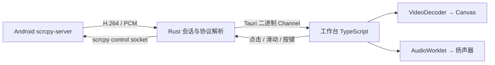

# scrcpy 音视频内嵌调研

调研日期：2026-11-12；实现约定更新：2026-11-13。用户已验收并采用本文技术路径；实施与验证状态统一见 [路线图](../ROADMAP.md)。

已取得用户提供的本地源码位置和按需下载授权，具体资源与源码入口见 [开发准备说明](../development/scrcpy-setup.md)。下文保留调研依据；进度与验证结果以路线图为准。

## 结论与建议

可以让 Rust 接入 scrcpy 的设备端服务，将音视频和控制集成在 Tauri 自己的工作台页面中。推荐一个方向：**复用官方 `scrcpy-server`，Rust 管理连接与协议，TypeScript 使用 WebView 的媒体能力呈现。** 不启动另一个桌面 scrcpy 窗口。

官方 scrcpy 本身分为 Android 端 server 和桌面端 client；视频、音频、控制分别走独立 socket。因此“使用 scrcpy”并不要求使用它的 SDL 桌面窗口。这里需要实现一个精简的客户端适配层，并非引入一个现成的官方 Rust SDK。[官方开发说明](https://github.com/Genymobile/scrcpy/blob/v5.0.1/doc/develop.md)

建议首轮采用 H.264 视频与 raw PCM 音频，先验证当前 macOS 的真实 WKWebView。这样不用为第一版引入 FFmpeg、SDL、独立 WebSocket 服务或音视频转码服务。**这些是基于下述官方能力作出的工程判断，不是现有项目已经验证的性能结论。**

## 已查证的边界

| 问题 | 事实与影响 |
| --- | --- |
| scrcpy 是否有可直接嵌入的官方 Rust 播放库？ | 官方工程提供 C 桌面客户端和 Android Java 服务端。本次没有确认到可直接满足 Tauri 同页音视频、且适配当前协议的成熟 Rust SDK。应按维护小型协议适配层估算，而非“一行依赖即可嵌入”。 |
| 音频可以直接获得 PCM 吗？ | 官方支持 `audio_codec=raw`；固定版本源码为 48 kHz、双声道、16-bit PCM，小端。净数据量为 `48000 × 2 × 2 = 192000` 字节/秒，约 1.536 Mbit/s，不含协议开销。 |
| Android 音频支持范围？ | Android 11+；Android 11 开始捕获时需要解锁，Android 12+ 流程更直接。捕获失败可继续视频，但必须显示音频不可用及原因。 |
| macOS WebView 是否能解码？ | Tauri 使用系统 WKWebView；WebKit 在 Safari 16.4 加入视频 WebCodecs，Safari 26.0 才加入 `AudioDecoder`。不能把桌面 Chrome 或 Safari 的成功直接当作应用 WKWebView 已验证。 |
| 为什么用 PCM？ | AudioWorklet 早于 WebCodecs 音频接口获得 WebKit 支持，可避开首版对 Opus/AAC `AudioDecoder` 的依赖。代价是无线带宽增加，以及仍需编写音频缓冲、时钟处理。 |

依据：[官方项目结构](https://github.com/Genymobile/scrcpy/tree/v5.0.1)、[音频说明](https://github.com/Genymobile/scrcpy/blob/v5.0.1/doc/audio.md)、[AudioConfig.java](https://github.com/Genymobile/scrcpy/blob/v5.0.1/server/src/main/java/com/genymobile/scrcpy/audio/AudioConfig.java)、[Tauri WebView 说明](https://v2.tauri.app/reference/webview-versions/)、[WebKit 16.4](https://webkit.org/blog/13966/webkit-features-in-safari-16-4/)、[WebKit 26.0](https://webkit.org/blog/17333/webkit-features-in-safari-26-0/)、[WebKit AudioWorklet 支持](https://webkit.org/blog/11648/new-webkit-features-in-safari-14-1/)。

本次查看的 Rust 项目不能直接作为现成 SDK 选型依据：`scrcpy-mask` 是 Rust + Bevy + React 完整应用，README 明确其旧 Tauri 分支已不再维护，并使用自己的 server 分支；`rust-scrcpy-client` 的公开接口与依赖包含 Iced UI，未给出当前协议音视频嵌入保证。它们可以作为阅读参考，当前不引入为依赖。[scrcpy-mask README](https://github.com/AkiChase/scrcpy-mask/blob/master/README.md)、[rust-scrcpy-client Cargo.toml](https://github.com/xmsociety/rust-scrcpy-client/blob/master/Cargo.toml)、[公开 lib.rs](https://github.com/xmsociety/rust-scrcpy-client/blob/master/src/lib.rs)

## 项目中的最小职责划分

- **Rust `scrcpy` 模块**：推送并启动 server，建立 ADB 隧道，读取三路 socket，解析数据边界，管理唯一活动会话，序列化输入消息，停止并清理资源。优先复用项目的 ADB 命令执行封装。
- **TypeScript 投屏模块**：接收媒体包，配置视频解码器，绘制 Canvas，管理音频工作线程及静音，计算指针坐标。其余页面只调用 `start / stop / sendInput` 一类小接口。
- **Tauri IPC**：状态和普通命令使用现有 command；媒体使用独立二进制 Channel。媒体、音频和控制不能互相因一个慢队列而阻塞。

Tauri 官方明确普通 event 不适合高吞吐、低延迟数据；Channel 用于流式传输。原始二进制需要 `Channel<InvokeResponseBody>` 发送 `InvokeResponseBody::Raw`，前端接收 `ArrayBuffer`；`Channel<Vec<u8>>` 会序列化成 JSON 数字数组。[事件与 Channel](https://v2.tauri.app/develop/calling-frontend/)、[Rust Channel 原始载荷](https://docs.rs/tauri/latest/tauri/ipc/struct.Channel.html#raw-payloads)

**Channel 能传输不等于已有媒体背压。** 需要应用自己的有界队列与消费确认；前端通过轻量 command 批量返回消费进度，限制 Rust 尚未被消费的媒体数据。具体包数/字节限额由验证结果确定，不能无限调用 `send()`。不要 Base64 化视频帧，也不把解码后的整帧 RGB 经 IPC 传输。

## 固定版本与协议核对

本次使用官方发布 API 核实到 **v5.0.1**，以下细节均以该 tag 的源码为准。实施时一起锁定 server 资源、启动版本参数、解析器和控制消息布局；server 会检查客户端版本完全一致。打包保存下载来源、版本及校验值，运行时不自动追随 `latest`。[官方发布](https://github.com/Genymobile/scrcpy/releases/tag/v5.0.1)、[Options.java 版本检查](https://github.com/Genymobile/scrcpy/blob/v5.0.1/server/src/main/java/com/genymobile/scrcpy/Options.java)

该 tag 的 `develop.md` 仍含“4.0”描述文字；遇到冲突以同 tag 的发送端与读取端源码互相核对。**不能直接套用旧版本“视频开头 codec + 宽高”或旧配置标志位的教程。**

### 连接与生命周期

推荐使用 `adb -s <serial> forward tcp:0 localabstract:scrcpy_<scid>` 分配本机会话端口，配合 `tunnel_forward=true`。Rust 再按视频、音频、控制顺序连接同一转发端口。每次连接生成会话标识，所有设备命令绑定明确 serial；`scid` 启动参数使用十六进制。连接建立和启动进程都设置超时。[DesktopConnection.java](https://github.com/Genymobile/scrcpy/blob/v5.0.1/server/src/main/java/com/genymobile/scrcpy/device/DesktopConnection.java)、[Options.java](https://github.com/Genymobile/scrcpy/blob/v5.0.1/server/src/main/java/com/genymobile/scrcpy/Options.java)、[ADB forward 说明](https://android.googlesource.com/platform/packages/modules/adb/+/refs/heads/main/docs/user/adb.1.md)

保留元数据时，forward 模式的**第一条** socket 先读 dummy byte，再读 64 字节设备名；随后分别处理各媒体流的 codec header。默认开启 video/audio/control 时需建立三条连接，即使最终设备报告音频不可用。不要顺序等待首条完整媒体流才连接后两条。

停止、断连、切换设备和窗口关闭共用一个幂等清理流程：停止接收与发送、关闭三条 socket、回收本次 server 启动进程、移除本次 forward、关闭前端 decoder/audio context、丢弃旧会话回调。只处理本应用拥有的资源，不用 `adb kill-server` 代替会话清理。以会话 ID 隔离晚到的输出；新设备不得收到旧设备的输入。

### v5.0.1 数据分帧

| 数据 | 固定版本的格式 |
| --- | --- |
| 视频/音频初始头 | 各 4 字节、大端 codec ID；视频 H.264 为 `0x68323634`，raw 音频为 `0x00726177`。 |
| 视频 session 元数据 | 12 字节；最高位为 1，后 8 字节为大端宽、高，中间包含 client-resized 标记。初次捕获和尺寸/方向改变后都可能出现；它没有后续媒体载荷。 |
| 普通媒体包 | 12 字节头 + payload；前 8 字节为 flags/微秒 PTS，后 4 字节为大端 payload 长度。 |
| 标志位 | bit 63 区分 session；普通包 bit 62 为 codec configuration，bit 61 为关键帧，其余低 61 位为 PTS。配置包不能当作有有效 PTS 的普通视频帧播放。 |
| 禁用或错误 | codec ID `0` 表示该流不可用，`1` 表示配置错误；不可当作 H.264/PCM 数据继续解码。 |

解析器必须处理 TCP 分包/粘包、短读、EOF、载荷长度上限和半包中断。**视频 session 记录与帧记录同为 12 字节，若未先识别最高位，会把高度误当作 payload 长度。** 对照来源：[Streamer.java](https://github.com/Genymobile/scrcpy/blob/v5.0.1/server/src/main/java/com/genymobile/scrcpy/device/Streamer.java)、[客户端 demuxer.c](https://github.com/Genymobile/scrcpy/blob/v5.0.1/app/src/demuxer.c)、[AudioRawRecorder.java](https://github.com/Genymobile/scrcpy/blob/v5.0.1/server/src/main/java/com/genymobile/scrcpy/audio/AudioRawRecorder.java)。

### 视频、音频与输入

**视频。** 解析 H.264 配置获取 SPS/PPS 与 codec string；以实际配置调用 `VideoDecoder.isConfigSupported()`，不能只检查 API 是否存在。首版使用 Annex B 数据：不提供 AVC `description`，关键帧须带所需参数集；遇到新配置、旋转和尺寸变化重新建立解码状态。收到 `VideoFrame` 绘制后立即 `close()`。[W3C AVC 注册规范](https://www.w3.org/TR/webcodecs-avc-codec-registration/)、[WebCodecs 规范](https://www.w3.org/TR/webcodecs/)

**音频。** 将 PCM16 LE 转成工作线程需要的浮点声道数据，使用 AudioWorklet 有界缓冲连续输出。用户点击“开始投屏/开启声音”时恢复 AudioContext；确认实际采样率，必要时重采样。先使用可调的小缓冲，以设备 PTS 和本地播放时钟建立映射，测量长期漂移再调节缓冲或重采样比例。不能把每个 PCM 包直接作为独立短声音立即播放，也不能假设本机音频设备必然运行在 48 kHz。[Web Audio 规范](https://www.w3.org/TR/webaudio-1.1/)

**背压与同步。** 解码前积压时不能任意删掉 H.264 参考帧后继续送后续 delta 帧；应限制 in-flight 数据，并在必要时重置、从配置与下一关键帧恢复。解码后的过期画面可以关闭并丢弃。音频欠载补静音、超载纠偏，声音不可用时视频继续；音视频同步偏差和端到端延迟必须在真实设备测量，原型的 60 FPS、14 ms 不是目标已实现的证据。

**输入。** 前端把 Canvas 内容区域的坐标映射到当前视频 session 的宽高，扣除留白并处理缩放；输入包同时携带该尺寸，server 再映射设备显示坐标。不能直接按原型 `1080×2400` 或固定 `wm size` 写死。旋转后以新 session 更新坐标；指针离开、取消、失焦时补齐松开。拖动 move 可合并，down/up、按键和停止消息保持顺序且不得丢失。[control_msg.c](https://github.com/Genymobile/scrcpy/blob/v5.0.1/app/src/control_msg.c)、[Controller.java](https://github.com/Genymobile/scrcpy/blob/v5.0.1/server/src/main/java/com/genymobile/scrcpy/control/Controller.java)

## 首个实现步骤的验证门槛

先做同页音视频最小验证，再展开完整工作台。以下属于验收检查点，不增加路线图阶段：

- 在**应用实际 WKWebView 和打包资源来源**中确认安全上下文、H.264 配置支持、AudioWorklet 模块加载、用户手势音频恢复及 CSP；不能只在 Vite 浏览器页面验证。
- 一台 Android 12+ 真机、USB、建议视频长边 1280、30 FPS 起步：显示连续画面、播放声音、完成点击和拖动；此配置是验证起点，不承诺最终性能上限。
- 播放含可观察同步点的音视频并运行至少 10 分钟，记录音画偏差、输入响应、内存趋势、队列峰值和断音情况。具体性能门槛据测量再定，不抄用官方桌面客户端指标。
- 旋转、窗口缩放、停止/重启、拔线、切设备后保持坐标正确且旧会话资源释放；再验证一次局域网无线连接与音频不可用降级。
- 固定版本的 session/config/keyframe 分帧必须有样本验证；完成后记录验证过的 macOS/WebKit、Android、ADB 和 server 版本。Windows/Linux 支持需在对应 WebView 独立验证。

若真实 WKWebView 无法满足解码、音频或传输要求，记录具体失败点后再与用户确认调整；不要同时铺设第二套播放器或静默退回独立 scrcpy 窗口。

## 对 PRD 的直接约束

- 保留工作台内画面、声音、快捷控制与命令终端共存；内嵌音视频是首版关键技术风险，应前置验证。
- 音频至少提供启停/静音与真实可用状态；部分 Android 版本或设备限制不能伪装为正常播放。
- scrcpy 投屏只呈现设备实际画面。原型里的折叠铰链值、模拟双屏和 `cmd sensor mock-hinge` 不由上述通道自动实现，本次未验证这些命令，也不将它们列作通用设备能力。
- 推荐打包固定 server 资源并保留 Apache-2.0 许可说明；ADB 可先使用本机路径配置，是否随包分发另行确定。[scrcpy LICENSE](https://github.com/Genymobile/scrcpy/blob/v5.0.1/LICENSE)

## 客户端实现约定

- Rust 在原始 12 字节媒体记录前增加 4 字节大端消费序号，经二进制 Channel 发送。视频最多 8 个未确认包，音频最多 24 个；前端每 40ms 合并确认，5 秒未消费则报告错误。
- 视频在解码器有容量后确认，AudioWorklet 在把 PCM 写入环形缓冲后确认，避免把无限消息积压转移到另一个线程。绘制队列最多 4 帧，主动释放过期 `VideoFrame`。
- PCM 环形缓冲容量 500ms，初始缓冲 80ms，目标约 100ms；按输出采样率重采样并微调时钟。该缓冲数值不是端到端延迟。
- 应用内一个活动会话之外，还通过 [Tauri 单实例插件](https://v2.tauri.app/plugin/single-instance/) 约束桌面进程，防止开发进程与打包应用同时采集、播放同一设备音频。重复启动只唤起现有窗口。
- 停止、正常退出及启动中取消均等待本会话资源清理；不使用 `forward --remove-all`，不影响其他 ADB 任务。系统强制终止后的清理不作保证。
- macOS 的原生退出路径可能跳过 `ExitRequested`，因此最终 `Exit` 回调也等待清理；依据为本项目依赖源码和 [Tauri 上游问题](https://github.com/tauri-apps/tauri/issues/12978)。不能仅处理关闭窗口或退出请求事件。
